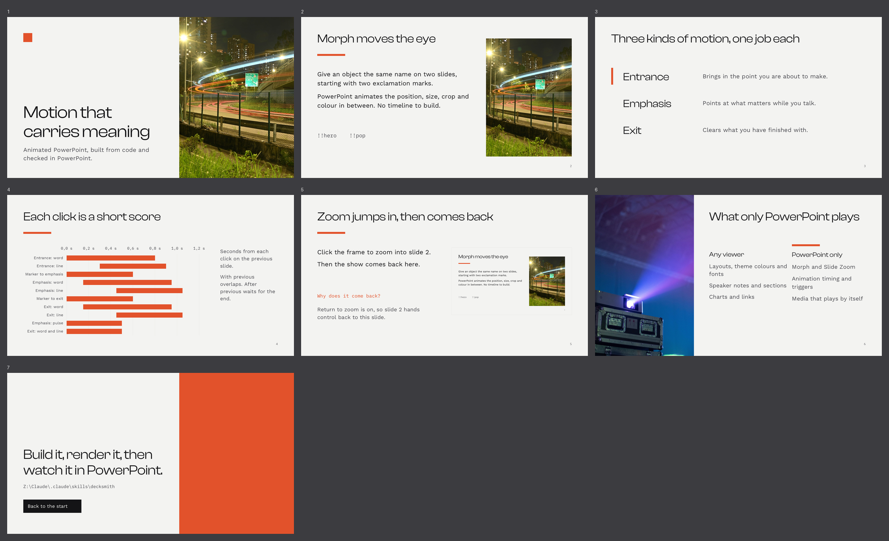
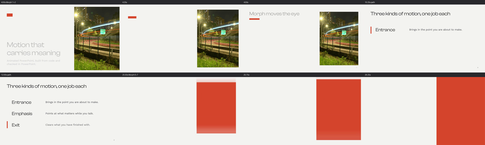

# Decksmith

A Claude Code plugin for building **animated PowerPoint decks from code**, with real
PowerPoint motion, a deliberate design system, and proof that the file works in
PowerPoint before anyone presents it.

python-pptx builds slides, but it has no API for animation, transitions, Morph, Slide
Zoom or sections. Decksmith writes that XML directly. Every effect template was copied
from a file PowerPoint 365 saved itself, so PowerPoint lists the effects by their real
names (Fade, Float In, Wipe, Pulse...), not as anonymous custom effects. Then it opens
the result in the real PowerPoint, checks that every effect loaded, and exports slide
images and a video in which the animation actually plays.





## Install

```
/plugin marketplace add JahooClou/decksmith
/plugin install decksmith@decksmith
```

Then ask for a deck ("an animated 8-slide pitch for ...", "Morph the photo from the cover
into slide 2", "check my deck in PowerPoint"), or invoke it directly with `/decksmith`.

**Requirements:** Python 3.10+ with `python-pptx`, `lxml` and `Pillow`. On Windows with
PowerPoint installed, the full check runs through PowerPoint (PowerShell + COM, no extra
packages). Without PowerPoint it falls back to LibreOffice (`soffice`, plus `PyMuPDF`),
which shows layout but no motion. `ffmpeg` for video stills. The demo's text faces are
Clash Display, Work Sans and IBM Plex Mono; swap them in `master.Theme` for fonts you have.

## What it covers

- **Animation:** 19 effects across entrance, emphasis, exit and motion path. Start on
  click, with previous or after previous, plus delays, durations, easing, repeats,
  paragraph builds and cascades.
- **Morph:** `!!` naming so objects pair across slides, with the right Fade fallback for
  older viewers. Other transitions: fade, push, wipe, split, cover, pull, zoom, cut, and
  auto-advance.
- **Interaction:** triggers (click a shape to reveal), Slide Zoom with return-to-parent,
  links and action buttons.
- **Structure:** its own theme colours and fonts, a rebuilt slide master, named layouts,
  sections and speaker notes.
- **Media:** embedded video or audio that starts on its own, loops, and sets its volume.
- **Design rules:** taste-skill's principles restated for slides (one accent, three
  faces, no em dashes, 45 words a slide, motion only with a reason), with a checklist
  to run before delivery.
- **Vector first:** asks for SVG versions up front. Logos go in whole as SVG pictures;
  icons, arrows and diagram parts become native PowerPoint freeforms you can recolour
  (`svgshapes.py`); gradients are native fills.
- **Image guide:** every picture is planned as a frame. The guide gives its exact pixel
  size at 1080p and 4K, the topic, and a Pexels.com proposition with an exact-size crop
  URL. See [the demo's guide](examples/demo/image-guide.md).
- **Verification:**
  - `validate.py` catches XML that PowerPoint would repair or silently drop.
  - `render.py` opens the deck in PowerPoint, compares PowerPoint's effect and trigger
    counts with the XML, and exports PNGs, a contact sheet, an MP4 and stills.

## Field notes worth having

- **Motion paths always start from the shape's place on the slide**, not from where the
  previous path ended. A second "move down" snaps back first. Decksmith chains paths for you.
- A font family name proves nothing until you look at the render. Here "Barlow" came out
  as ExtraBold Italic, because only that weight was installed as TrueType.
- Opening a file through COM tolerates out-of-order and unknown timing XML. It fails
  (0x80070570, the UI's repair prompt) when an animation targets a shape that does not
  exist. So: validate for structure, then compare PowerPoint's counts.
- Morph, Slide Zoom, triggers and exact timing play only in PowerPoint 365 / 2019 and
  later. Keynote, Google Slides and LibreOffice show the fallback fade. A PDF shows every
  slide in its final built state.

## Contents

```
skills/decksmith/
  SKILL.md                    the workflow
  references/
    design-rules.md           taste-skill for slides + pre-delivery checklist
    animation.md              timing model, effects, Morph, zoom, triggers, media, support matrix
    images.md                 picture slots, exact px, Pexels sourcing, the image guide
    masters.md                theme, master, layouts, placeholders, font gotchas
    xml-reference.md          the XML PowerPoint writes, and how to get more from PowerPoint itself
  scripts/
    master.py motion.py images.py svgshapes.py     the libraries
    svg_logos.ps1                                  SVG logos through PowerPoint
    validate.py render.py ppt_render.ps1 image_guide.py   the checks
    build_demo.py selftest.py                      the worked example and the self-test
  assets/base-16x9.pptx       empty 16:9 package saved by PowerPoint
examples/demo/                the demo deck, its image guide and Pexels picks
```

## Credits

- Design rules are adapted from [taste-skill](https://github.com/leonxlnx/taste-skill) by
  Leonxlnx (MIT), restated for slides. That repo is the source of the reasoning.
- Demo photos come from Pexels, used under the [Pexels licence](https://www.pexels.com/license/):
  [Car Lights Trails on Road Curve in City](https://www.pexels.com/photo/18473029/) by
  [King Ho](https://www.pexels.com/@king/), and
  [Light of Projector](https://www.pexels.com/photo/20728625/) by
  [Natasha Latinovska](https://www.pexels.com/@natasha-latinovska-1052962659/).
- Slide Zoom XML follows Microsoft's MS-PPTX specification.

## Licence

MIT. See [LICENSE](LICENSE). The demo photos remain under the Pexels licence.
